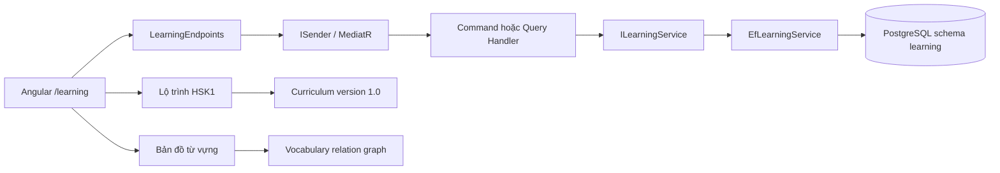
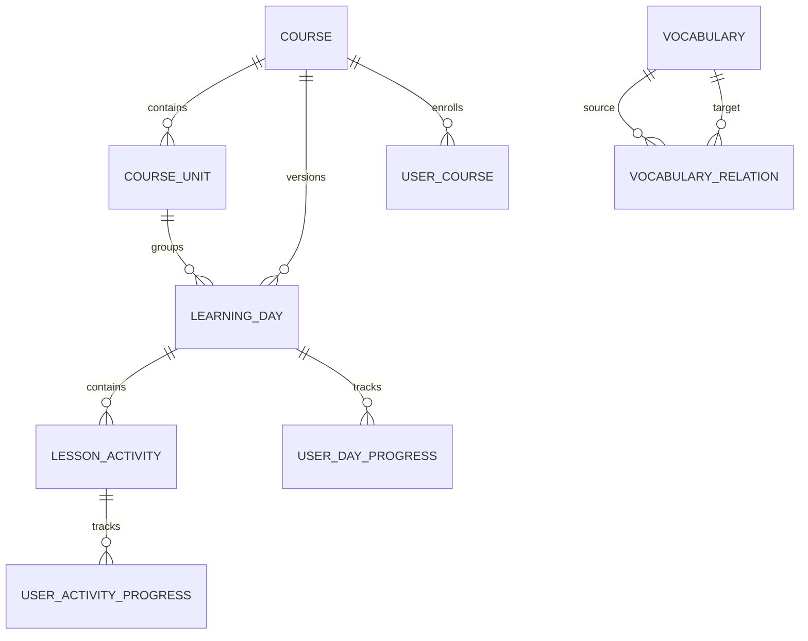
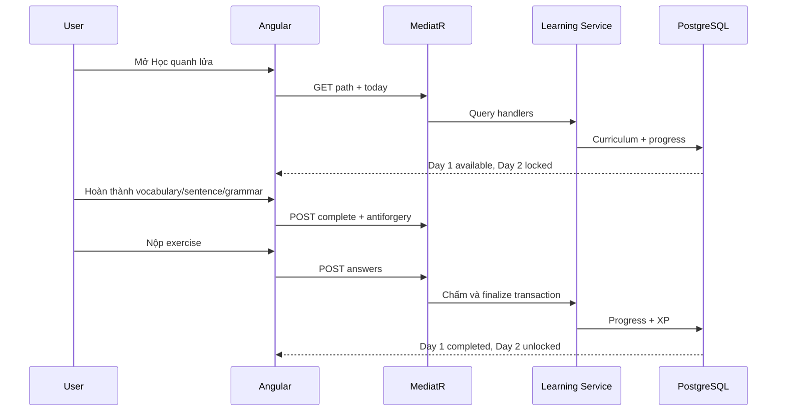

# Học quanh lửa — bản đồ triển khai

Ngày cập nhật: 26/10/2026

## Kiến trúc đã triển khai

HSK1 là dữ liệu seed có version. Learning Engine là code dùng chung, vì vậy thêm HSK2, HSK3 hoặc khóa giao tiếp không cần tạo controller/component riêng cho từng ngày.

## Bài toán nhỏ, giải pháp và vị trí code

| Bài toán | Cách giải quyết | File chính |
|---|---|---|
| Giữ modular monolith | Module riêng đủ Domain, Application, Infrastructure, Presentation, Contracts; Host chỉ composition | `backend/src/Modules/Learning/*`, `backend/src/Host/Campfire.Api/Composition/*` |
| Dispatch đúng MediatR | Endpoint gọi `ISender`; handler chỉ gọi port Application | `LearningEndpoints.cs`, `*CommandHandler.cs`, `*QueryHandler.cs` |
| Curriculum không hard-code ở UI | Course/Unit/Day/Activity và JSON content được seed bằng migration idempotent | `LearningSeed.cs`, `Migrations/*InitialLearning.cs` |
| Không lộ đáp án | Loại `correctAnswer` trước khi trả activity; chấm server-side | `ExerciseScorer.cs`, `EfLearningService.cs` |
| Không cộng XP lặp | PK `(UserId, ActivityId)`, transaction Serializable và hoàn thành day idempotent | `UserActivityProgress.cs`, `UserLearningDayProgress.cs`, `EfLearningService.cs` |
| Mở khóa tuần tự | Ngày N yêu cầu ngày N-1 `Completed`, kiểm tra lại ở mọi mutation | `EfLearningService.CanAccessDayAsync` |
| Không xuyên schema Identity | Chỉ lưu `UserId` UUID, không FK/navigation tới schema `identity` | `LearningDbContext.cs` |
| Mind map chưa có AI provider | Trả graph curriculum đã kiểm duyệt; từ ngoài dữ liệu trả lỗi rõ ràng | `GetMindMapQuery*`, `EfLearningService.GetMindMapAsync` |
| Không dựng nút AI giả | Capability API công bố provider đang tắt; UI giải thích giới hạn | `GetCapabilitiesQuery*`, `learning-page.html` |
| Bảo vệ mutation | Identity authorization, antiforgery, FluentValidation và ProblemDetails có traceId | `LearningEndpoints.cs`, `AntiforgeryEndpointFilter.cs`, validators |
| Mobile/dark mode | Semantic design tokens, layout một cột dưới 900px, touch target 44px | `frontend/src/app/features/learning/learning-page.scss` |

## Mô hình dữ liệu

- Unique: course slug, `(CourseId, DayNumber)`, `(LearningDayId, OrderIndex)`, progress composite keys, `(Chinese, HskLevel)`.
- Check constraint: HSK 1–6, score/progress 0–100, XP không âm, allow-list status/activity/relation.
- Thời gian enrollment/completion dùng UTC `timestamptz`.
- Rollback migration đầu tiên xóa schema Learning và toàn bộ progress; production phải sao lưu trước khi rollback.

## Luồng học đang chạy

## Chưa giả lập

TTS, upload microphone, pronunciation/tone assessment, conversation AI, AI vocabulary expansion và smart review chưa hoạt động vì chưa có provider/credential/storage. Phase sau phải thêm Application port và Infrastructure adapter; endpoint không được gọi provider trực tiếp.
